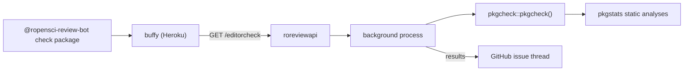

## Summary

The [ropensci-review-tools](https://github.com/ropensci-review-tools) GitHub organization hosts the R packages that automate package checking for review.[^packages] In the live system they run **inside the [roreviewapi](./roreviewapi.md) Docker container** (invoked through the `/editorcheck`, `/pkgmatch`, and `/srrcheck` endpoints), and authors can also run them locally before submitting.[^endpoints]

## The packages

| Package | Local clone | Role in review |
| --- | --- | --- |
| `pkgcheck` | `ropensci-review-tools/pkgcheck` | Final pre-submission gate: authors run `pkgcheck::pkgcheck()` to confirm a package is ready to submit; returns detailed check results.[^overview] Powers `/editorcheck`. |
| `pkgstats` | `ropensci-review-tools/pkgstats` | Static code analyses for R packages (needs `ctags` and GNU `global`); used by pkgcheck. |
| `autotest` | `ropensci-review-tools/autotest` | Mutation testing of function parameters; meant for continuous use from early development so reviews uncover fewer behavioural bugs.[^overview] |
| `srr` | `ropensci-review-tools/srr` | Lets authors document compliance with rOpenSci's statistical-software standards inside their code (roxygen roclets).[^overview] Powers `/srrcheck`. |
| `pkgmatch` | - (not cloned) | Finds top-5 similar packages in the rOpenSci and CRAN corpora; powers `/pkgmatch`.[^endpoints] |
| `pkgcheck-action` | `ropensci-review-tools/pkgcheck-action` | GitHub Action wrapping pkgcheck for CI use. |
| `goodpractice` | - (not cloned) | General package-building advice; the review repo's `.buffy/templates/goodpractice.md` comment template is named after it. |

## Where they plug into the system

pkgcheck runs as a **background process** on the server with stdout/stderr to logfiles, because checks are long-running; results land in the issue thread when done, and maintainers can inspect `/stdlogs` for debugging.[^endpoints] Analyzed packages are cached on the server (`/clear_cache` invalidates).[^endpoints]

## Related

- [Software peer-review infrastructure architecture](./software-peer-review-architecture.md) - system overview
- [roreviewapi](./roreviewapi.md) - the API that hosts these checks

[^overview]: Source `overview` - see frontmatter `sources`.
[^packages]: Source `packages` - see frontmatter `sources`.
[^endpoints]: Source `endpoints` - see frontmatter `sources`.