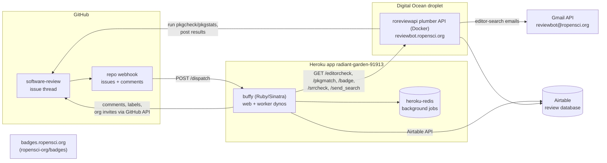

## Summary

rOpenSci software peer review runs as **chat-ops**: every review is a GitHub issue thread on [ropensci/software-review](https://github.com/ropensci/software-review), and humans drive automation by typing commands addressed to the bot account `@ropensci-review-bot` in issue comments.[^blog] A Ruby app (**buffy**, fork at [ropensci-org/buffy](https://github.com/ropensci-org/buffy)) deployed on **Heroku** receives GitHub webhooks, matches comments against registered commands, and orchestrates the work: calling the **roreviewapi** plumber API, filling the **Airtable** review database, managing the GitHub organization, and posting results back into the issue thread.[^blog]

## System diagram

## Components

| Component | Repo (local clone path) | Runs where | Role |
| --- | --- | --- | --- |
| Review venue | `ropensci/software-review` | github.com | Issue templates, label lifecycle, `.buffy/templates` bot comment templates |
| Bot face | - | github.com user @ropensci-review-bot | Account commands are addressed to; its PAT posts comments[^buffy-install] |
| buffy | `ropensci-org/buffy` (production config on `ropensci` branch) | Heroku `radiant-garden-91913` | Command router and orchestrator[^blog][^buffy-config][^heroku] |
| roreviewapi | `ropensci-review-tools/roreviewapi` | Digital Ocean droplet, Docker, `https://reviewbot.ropensci.org` | plumber API: package checks, editor-search emails, badges[^endpoints][^editorsearch] |
| pkgcheck suite | `ropensci-review-tools/{pkgcheck,pkgstats,autotest,srr,pkgmatch}` | inside roreviewapi container + author machines | The actual check machinery[^overview] |
| Badges | `ropensci-org/badges` | badges.ropensci.org | SVG badges showing review status |
| Dashboard | `ropensci-review-tools/dashboard` | dashboard.ropensci.org (quarto) | Editorial view of the review pipeline |
| Review database | - | Airtable | Editors, reviewers, submissions; written by buffy via the Airtable API[^blog][^heroku] |

## Request flow: `@ropensci-review-bot check package`

1. A user comments on a submission issue. GitHub sends an `issue_comment` webhook event to the buffy app's `/dispatch` path (webhook secret = `BUFFY_GH_SECRET_TOKEN`).[^buffy-install]
2. buffy matches the comment against registered responders in `config/settings-production.yml` on the fork's `ropensci` branch. `check package` maps to an `external_service` responder named `editorcheck`.[^buffy-config]
3. buffy issues `GET https://reviewbot.ropensci.org/editorcheck?repo=...&repourl=...&issue_id=...&secret=<PKGCHECK_TOKEN>`.[^buffy-config]
4. roreviewapi validates the issue template variables, then starts `pkgcheck::pkgcheck()` as a background process with stdout/stderr to logfiles (retrievable via the `/stdlogs` endpoint).[^endpoints]
5. Check results are posted back into the GitHub issue thread; buffy formats replies using templates from the review repo's `.buffy/templates/` (e.g. `goodpractice.md`).[^buffy-config]

## Label lifecycle (from production config)

`0/presubmission` / `0/editorial-team-prep` -> `1/editor-checks` (assign editor) -> `2/seeking-reviewer(s)` -> `3/reviewer(s)-assigned` -> `4/review(s)-in-awaiting-changes` -> `5/awaiting-reviewer(s)-response` -> `6/approved`. Stats submissions additionally carry `stats` and grade labels like `6/approved-bronze-v0.0.1`.[^buffy-config]

## Secrets and access (names only - values are never stored in this KB)

- Heroku config vars: `BUFFY_BOT_GH_USER`, `BUFFY_GH_ACCESS_TOKEN`, `BUFFY_GH_SECRET_TOKEN`, `AIRTABLE_API_KEY`, `AIRTABLE_BASE_ID`, `PKGCHECK_TOKEN`, `REDIS_URL`, `CUSTOM_RUBY_VERSION`, `RACK_ENV`, `WEB_CONCURRENCY`.[^heroku]
- roreviewapi droplet `.env`: `GITHUB_TOKEN`, Gmail OAuth vars (`GMAIL_SENDER`, `GMAIL_OAUTH_CLIENT_SECRET`, `GMAIL_TOKEN_CACHE`, `GMAIL_AUTH_EMAIL`).[^editorsearch]

## Related

- [buffy](./buffy.md) - the bot itself
- [roreviewapi](./roreviewapi.md) - the plumber API
- [pkgcheck suite](./pkgcheck-suite.md) - the check machinery
- [software-review repository](./software-review-repo.md) - the venue
- [Badges service](./badges-service.md)
- [Review dashboard](./review-dashboard.md)

[^blog]: Source `blog` - see frontmatter `sources`.
[^buffy-config]: Source `buffy-config` - see frontmatter `sources`.
[^buffy-install]: Source `buffy-install` - see frontmatter `sources`.
[^endpoints]: Source `endpoints` - see frontmatter `sources`.
[^editorsearch]: Source `editorsearch` - see frontmatter `sources`.
[^heroku]: Source `heroku` - see frontmatter `sources`.
[^overview]: Source `overview` - see frontmatter `sources`.
